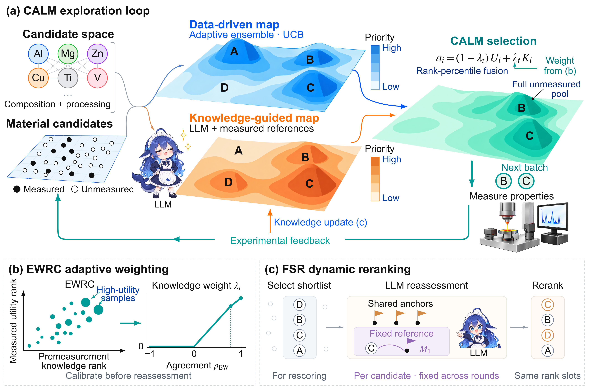

# CALM – Calibrated Adaptive Learning Method

Code for **CALM A Self Adaptive Knowledge Data Framework for Universal Metallic Materials Exploration**.



*Figure 2 from the paper: the CALM exploration loop, EWRC-based adaptive weighting, and feedback-guided shortlist reranking (FSR).*

CALM combines a calibrated GPR/RFR/bootstrap-LightGBM/MLP ensemble with LLM-derived materials knowledge. Feedback-guided shortlist reranking (FSR) updates knowledge ranks using measured anchors and persistent candidate references. Extreme-weighted rank correlation (EWRC) adapts the knowledge weight:

$$
a(x)=(1-\lambda)\operatorname{rankpct}(UCB(x))+
\lambda\operatorname{rankpct}(s_K(x)),\qquad
\lambda=\operatorname{clip}\left(0.6\max(\rho_{\mathrm{EW}},0),0,0.6\right).
$$

Inputs are raw compositions, available processing/testing conditions, categorical encodings and missingness indicators. The method uses X-only feature filtering, a standard 64→32→16 MLP and no retrieval augmentation.

## Installation

Use **Python 3.9.21**. The reference PyTorch build is **2.7.0 with CUDA 12.8** for Linux or Windows:

```bash
python -m pip install torch==2.7.0 --index-url https://download.pytorch.org/whl/cu128
python -m pip install -r requirements.txt
```

The PyTorch command follows the [official installation instructions](https://pytorch.org/get-started/previous-versions/#v270).

If a Windows Conda environment reports duplicate OpenMP runtimes (`OMP: Error #15`), set [MKL's sequential threading layer](https://www.intel.com/content/www/us/en/docs/onemkl/developer-guide-windows/2026-0/dynamic-select-the-interface-and-threading-layer.html) before starting Python:

```powershell
$env:MKL_THREADING_LAYER = "SEQUENTIAL"
```

This setting applies to the current shell and runs MKL operations in single-threaded mode.

## API configuration

Copy [`common/llm/.env.example`](common/llm/.env.example) to `common/llm/.env` and fill in the key:

```dotenv
CALM_API_BASE_URL=https://api.example.com/v1
CALM_LLM_MODEL=deepseek-v4-flash-ascend
CALM_API_KEY=
```

The endpoint must support OpenAI-compatible chat completions with JSON-object responses. The example uses the paper's service and model; change both for another provider. Shell variables override `.env`. For multiple distinct keys, number them consecutively from `CALM_API_KEY_1` to `CALM_API_KEY_4` and select one with `--api-key-slot`. Credentials stay local.

## Run the paper comparisons

Start with one paired run, or use all ten paper runs:

```bash
python run.py --dataset 2xxx_T6__UTS --n-runs 1
python run.py --dataset 2xxx_T6__UTS
```

Both commands perform remote LLM scoring and may incur API charges. The default main comparison includes **CALM and eight baselines**: Random, GPR-UCB, RFR-UCB, GBDT-UCB, NN-UCB, Adaptive-UCB, LLM-rank and LLM-dynamic. To include CALM-static, as in the supplementary comparison:

```bash
python run.py --dataset 2xxx_T6__UTS --experiment supplementary
```

Initialization uses 10% of the candidate pool, batches use 2%, and the total measurement budget is 40%, including initialization. Counts follow the paper's rounding rules and the final batch is truncated. Strategies share initial sets, inputs and measurement schedules, then learn from their own observations.

Default seeds match the selected manuscript cohort in [`calm/benchmark.py`](calm/benchmark.py), including the Mg UTS seed group and recorded run replacements. The cohort is descriptive and was selected after inspecting results. `--n-runs` takes the first requested paper runs; `--seed 42` instead generates a new paired experiment. Fresh API responses and the revised implementation are not an archive of the published result trajectories.

## Module ablations

Use `--experiment` to run one of the five configurations in the paper:

| Value | FSR | Knowledge weighting |
|---|---|---|
| `full` | Enabled | EWRC, γ=2 |
| `no-fsr` | Disabled | EWRC, γ=2 |
| `no-ewrc` | Enabled | Fixed λ=0.3 |
| `no-fsr-no-ewrc` | Disabled | Fixed λ=0.3 |
| `spearman` | Enabled | Ordinary Spearman, γ=0 |

```bash
python run.py --dataset 2xxx_T6__UTS --experiment no-ewrc
python run.py --help
```

Ablations retain the same ensemble, knowledge branch and paired initialization, and use their own measured feedback.

## Data

The registered tasks match the nine tasks in the manuscript. Six bundled CSVs support seven tasks; HEA Invar and MPEA require separately supplied prepared inputs.

| Task ID | Property | Direction | Candidates | Included |
|---|---|---|---:|---|
| `Cu_alloys__EC` | Electrical conductivity | Maximize | 1486 | Yes |
| `HEA_Invar__TEC` | Thermal expansion | Minimize | 709 | No |
| `MPEA__UTS` | Ultimate strength | Maximize | 362 | No |
| `mg_alloy__UTS` | Ultimate tensile strength | Maximize | 289 | Yes |
| `Ti_alloy__YS` | Yield strength | Maximize | 248 | Yes |
| `Ti_alloy__UTS` | Ultimate tensile strength | Maximize | 185 | Yes |
| `mg_alloy__YS` | Yield strength | Maximize | 298 | Yes |
| `2xxx_T6__EL` | Elongation | Maximize | 134 | Yes |
| `2xxx_T6__UTS` | Ultimate tensile strength | Maximize | 138 | Yes |

See [DATA_SOURCES.md](DATA_SOURCES.md) for sources, composition units and preparation. Unknown inputs remain missing, and all target/auxiliary-property columns are excluded from model and LLM inputs. Al UTS and EL share one table.

For another dataset, register a `DatasetConfig` in [`calm/runner.py`](calm/runner.py) and use an explicit `--seed` for new runs. Supply a deduplicated CSV and matching column/deduplication records with recalculated hashes and row counts; see the [Al CSV](dabase/curated/al_alloys.csv), [column definitions](dabase/curated/al_alloys.columns.json) and [deduplication record](dabase/curated/al_alloys.dedup.json). Set the target, direction, composition unit and auxiliary-property exclusions explicitly; use `REPORTED_COMPOSITION_POLICY` when composition fields are unreported.

Missing or inconsistent column records stop the run before API calls; they are never regenerated during a benchmark. Direct users of `LLMReviewer` must also supply `element_cols` and `process_cols` explicitly; `process_cols=[]` is valid.

## Outputs and code

Default results go to `outputs/calm_paper_v1/<dataset>/`; other experiments and overrides use a separate `_custom/<hash>/<dataset>/` directory. Static knowledge scores are shared across comparisons under `outputs/calm_paper_v1/_static/`. Resume requires matching code, data, configuration and the same static scoring generation.

Repeating a completed run preserves its results. Existing outputs from older code are also preserved and cannot be resumed with a different implementation. For an independent rerun with a fresh static-scoring cache, choose a new root:

```bash
python run.py --dataset 2xxx_T6__UTS --output-root outputs/rerun_01
```

| File | Contents |
|---|---|
| `convergence.json` | Per-run selections and best-so-far trajectories |
| `stats.json` | nAUC, Hit@budget, first-hit summaries and paired nAUC differences |
| `convergence_plot.png` | Mean trajectories with sample-standard-deviation bands |

`run.py` is the entry point; `calm/` contains the acquisition loop, strategies and metrics; `common/` contains raw-feature filtering, the MLP and LLM scoring. The main search metric is normalized regret AUC (lower is better). Summary comparisons report paired mean differences and sample standard deviations.

## Citation and license

Please cite **CALM A Self Adaptive Knowledge Data Framework for Universal Metallic Materials Exploration** and the [CALM repository](https://github.com/Tyler-gt/CALM).

Code is released under the [MIT License](LICENSE). Datasets retain the terms in [DATA_SOURCES.md](DATA_SOURCES.md).
